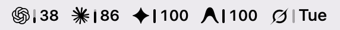
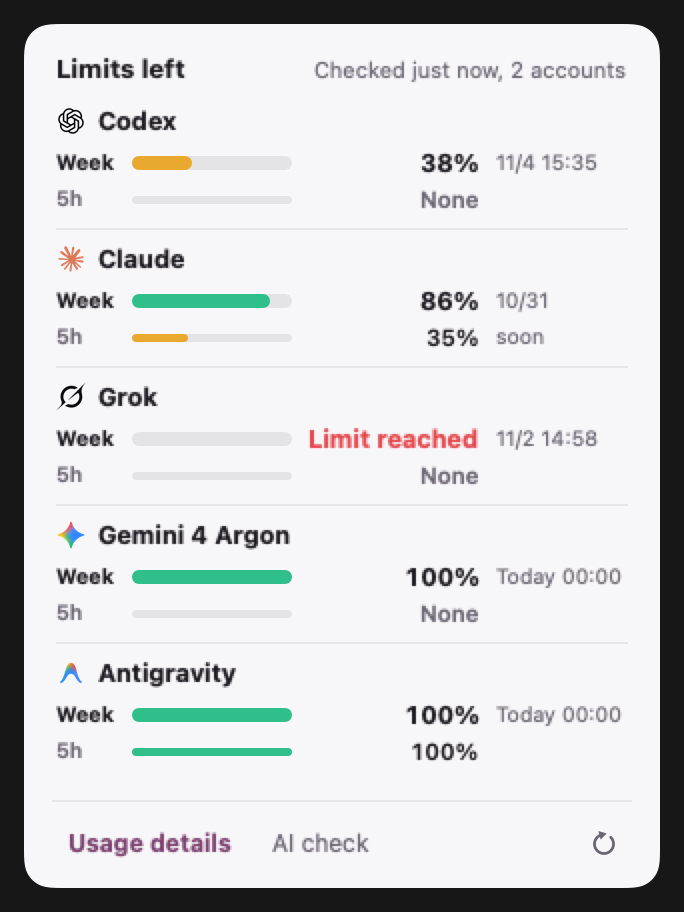
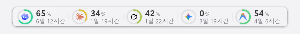

# UsageGauge

## Your AI quota, in sight

See the weekly quota you have left in Claude Code, Codex, Grok and Antigravity without opening a terminal to check.
Works on **Windows** (next to the taskbar clock) and **macOS** (in the menu bar).


<picture>
  <source media="(prefers-color-scheme: dark)" srcset="docs/mac-menubar-dark.png">
  
</picture>

**[Download for Windows](https://github.com/oksk4524/usage-gauge/releases/latest/download/UsageGauge-Setup.exe)** | **[Install on macOS](#macos)**

Free and open source. Windows 10/11 and macOS 13 or later. Uses your existing local tool logins.

## Check before you switch

When Claude is running low, it helps to know what Codex has left. UsageGauge puts your tools together so you can check them without leaving your work.

Each gauge shows **weekly quota remaining**, with the time until it resets. Hover for the exact reset time. You do not need a dashboard or terminal window open just to see where you stand.

## On the Mac

The macOS version is a native menu bar app with the same readings as the Windows widget.



- **In the menu bar:** each service you use gets its logo, a small bar and the weekly percent left. A service that has reached its limit dims and shows the day it refills.
- **Hover** for the exact numbers and reset times.
- **Click** for one row per service, with the weekly limit and the 5-hour limit side by side, and when each resets.
- **Refresh** shows what each service is doing: checking now, or how long until it may be asked again (the services limit how often they can be checked).
- **Follows your work:** it checks again shortly after you use Codex, Claude Code, Grok or Antigravity, instead of only on a timer.
- **English or Korean**, following your macOS language; right-click the menu bar item to switch or quit.

<br clear="right">

## Leave it running

It's genuinely lightweight, so you can keep it on while you work.

- **Windows:** native C# on .NET Framework, about 370 KB for the installer. Quota checks every five minutes for Codex, Claude and Grok, fifteen for Antigravity, paused after 15 minutes of inactivity.
- **macOS:** native Swift, no Electron or Node.js runtime. In a nine-minute measurement on a Mac Studio it used about 33 MB of memory and well under 1% CPU. It checks again soon after you use one of these tools, otherwise every three minutes (Antigravity: twenty).

Antigravity uses its own CLI for readings, which adds work during those refreshes.

## Make it fit your setup

On Windows, drag it where you want it. Right-click to choose the services you see, switch between English and Korean, or change whether it starts with Windows. On macOS, right-click the menu bar item for language and quit.



You only need to set up the tools you actually use. UsageGauge shows services with supported local logins, rather than filling your screen with empty gauges.

Screenshots above were captured from earlier builds. The numbers are examples, not live readings.

## No new account

UsageGauge uses the logins your tools have already saved on this computer. Requests go directly to the corresponding service. There is no UsageGauge account, telemetry or collection server.

Logins are only read, never changed. When one expires, sign in again through the official tool.

## Install

### Windows

1. Sign in locally to at least one supported tool: **Codex CLI, Claude Code, Grok CLI or Antigravity CLI (`agy`)**.
2. Download and run **UsageGauge-Setup.exe**, then confirm installation.
3. Look next to the taskbar clock. Drag to move the widget; right-click for settings.

It starts with Windows by default. After quitting, reopen it from the Start menu. Remove it through **Settings > Apps > UsageGauge**.

The installer is **unsigned**, so Windows or antivirus software may warn. Check the [release and SHA-256](https://github.com/oksk4524/usage-gauge/releases/latest) before deciding to run it. Do not disable antivirus.

**[Download for Windows](https://github.com/oksk4524/usage-gauge/releases/latest/download/UsageGauge-Setup.exe)**

[Setup and troubleshooting](docs/QUICKSTART.md)

### macOS

macOS 13 or later. There is no download yet: you build the app on your own Mac with Apple's Command Line Tools (no Xcode project).

1. Sign in locally to at least one supported tool: **Codex CLI, Claude Code, Grok CLI or Antigravity CLI (`agy`)**.
2. Install the Command Line Tools if you don't have them: `xcode-select --install`
3. Build and open it:

```sh
git clone https://github.com/oksk4524/usage-gauge
cd usage-gauge
mac/build.sh                                   # builds mac/build/UsageGauge.app
cp -R mac/build/UsageGauge.app /Applications/
open /Applications/UsageGauge.app
```

4. Look at the right side of the menu bar. To start it at login, add it under **System Settings > General > Login Items**.

**Update:** right-click the menu bar item, choose **Quit**, then run `git pull && mac/build.sh` and copy the app again.
**Remove:** quit it, delete `/Applications/UsageGauge.app` and, if you like, `~/Library/Application Support/UsageGauge`.

The app is signed only on your Mac and not notarized; because you build it yourself, macOS normally opens it without a download warning.
Claude Code's login is read from the keychain item `Claude Code-credentials` through `/usr/bin/security`, which is usually already allowed for that item.
`mac/test.sh` runs the logic tests without network access. More in [mac/README.md](mac/README.md) (Korean).

## Questions

**Will it work with a website login?** No. Browser-only ChatGPT and Claude logins are not supported. A supported local tool login is required.

**Does it show quota used or quota left?** Quota left. 100% means the full weekly quota is still available. These are weekly pools, not a promise that every other rate limit is clear.

**What does an amber dot mean?** The last refresh failed and the reading is stale. The gauge keeps the last successful value, which may no longer be current.

**I pressed refresh on macOS and nothing changed.** Each service has a minimum gap between checks (Claude 90 seconds, Antigravity 10 minutes), because the services limit how often they can be asked. The line under the refresh button shows which service is being checked and how long the wait is.

**Is the Gemini gauge my Gemini web app limit?** No. It reads Antigravity's Gemini pool. Website, app and CLI quotas can differ.

**Is this official?** No. UsageGauge is an independent open-source project. It uses internal service endpoints, so provider changes can interrupt readings.

<details>
<summary>Build from source (Windows)</summary>

Windows' built-in .NET Framework C# compiler is used; no Electron or Node.js runtime.

```powershell
git clone https://github.com/oksk4524/usage-gauge
cd usage-gauge
powershell -ExecutionPolicy Bypass -File .\install.ps1 -Autostart
```

Without git: **Code > Download ZIP**, extract, then run the last command in that folder.
To remove a source installation, run the same command with `-Uninstall` instead of `-Autostart`.
To build the single-file installer without installing it:

```powershell
powershell -ExecutionPolicy Bypass -File .\install.ps1 -Package
```

Output: `dist\UsageGauge-Setup.exe`. Logos, LICENSE and NOTICE are embedded.

</details>

<details>
<summary>Technical details and limitations</summary>

## How it works

| Gauge | Source | Login read from (Windows) | Login read from (macOS) |
|---|---|---|---|
| Codex | `chatgpt.com/backend-api/wham/usage` | `~/.codex/auth.json` | `~/.codex/auth.json` |
| Claude | `api.anthropic.com/api/oauth/usage` | `~/.claude/.credentials.json` | Keychain item `Claude Code-credentials`, else `~/.claude/.credentials.json` |
| Grok | `cli-chat-proxy.grok.com/v1/billing` | `~/.grok/auth.json` | `~/.grok/auth.json` |
| Antigravity | `agy -p /usage --output-format json` | agy's own login | agy's own login |

These are the official tools' internal endpoints, not public APIs, and may change. On failure a gauge keeps its
last value with an amber dot; the reason goes to `%LOCALAPPDATA%\UsageGauge\error.log` on Windows and
`~/Library/Application Support/UsageGauge/menubar.log` on macOS (review and redact personal information before
sharing it in an issue).

**Credentials are read without being changed.** They are sent only to the corresponding service for authenticated
requests, not to a UsageGauge server, and are never logged. UsageGauge sends no OAuth refresh requests and never
writes or deletes provider login files. When a login expires, the gauge shows its last value and says *sign in*;
on Windows, click it to open that tool's own sign-in (`codex login`, `claude auth login`, `grok login`) in a
terminal. On HTTP 401 it re-reads the login and retries only when the official tool has already saved a different
access token. Antigravity runs the official CLI, whose own authentication behavior is controlled by that CLI.

On macOS, when Claude Code's saved token has expired, UsageGauge may run Claude Code once in the background
(no tools, no session) so that Claude Code renews its own login, at most every 20 minutes.

Polling: Windows every 5 minutes (Antigravity 15), paused while you're away. macOS looks again shortly after one
of these tools writes to its own files, and otherwise every 3 minutes (Antigravity 20), with a minimum gap per
service (Claude adapts between 90 seconds and 10 minutes when the service says it is asked too often).

## Known limitations

- Codex logins kept in the OS keyring (`cli_auth_credentials_store = "keyring"`/`"auto"`) aren't read. On Windows, Claude Code credentials must be in a local `.credentials.json` file (the default path or `CLAUDE_CONFIG_DIR`).
- Several Grok accounts in `auth.json`: the Grok gauge stays off (can't tell which is active).
- `agy` installed but not signed in: the Antigravity gauges show an error.
- Windows: scaling is read at start-up. After changing it, or moving the widget to a monitor with different scaling, restart the widget.
- Some antivirus tools flag unsigned programs that read login files and use the network. The whole Windows source is
  `UsageGauge.cs`; `install.ps1` builds it on your PC. The macOS source is in `mac/Sources`.
- Unofficial; use at your own risk. Windows test overrides: `USAGEGAUGE_SCALE` (e.g. `1.5`), `USAGEGAUGE_THEME` (`light`/`dark`).

</details>

## Credits & license

Inspired by [CodexBar](https://github.com/steipete/CodexBar) / [Win-CodexBar](https://github.com/nesszer/Win-CodexBar);
current service logos come from official sites or official press kits, checked on 2026-10-29 (see [source records](assets/service-logos.json) and [NOTICE](NOTICE)).
Product names and logos belong to OpenAI, Anthropic, xAI, Google and Aside Computer Inc.; this project isn't affiliated with them. MIT.
