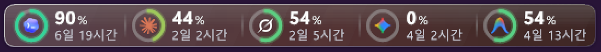
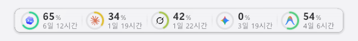
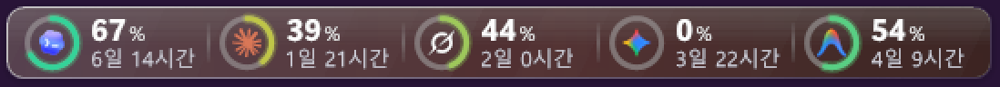

# UsageGauge

A tiny Windows taskbar widget that shows how much of your **weekly** quota is left for
Codex, Claude, Grok and Antigravity (Gemini, and Claude/GPT inside Antigravity).





- Glass ring gauges docked on the taskbar, with time left until each weekly reset.
- Hides instantly over fullscreen apps, stays above the taskbar.
- About 30 MB RAM and well under 1% of one CPU core. One ~70 KB executable, no runtime to install.
- No third-party helper: it reads usage straight from each service with the login the official tool already saved on your PC.
- Only shows the services you actually use (a gauge appears when that tool's login is on your PC); hide any of them from the right-click menu.
- Follows the display scaling in effect when it starts (100-300%) and light/dark taskbars.
- English or Korean, following the Windows display language (any other language falls back to English). Override it from the right-click menu.

## Where the numbers come from

| Gauge | Source | Login it uses |
|---|---|---|
| Codex | `chatgpt.com/backend-api/wham/usage` | `~/.codex/auth.json` (Codex CLI / app) |
| Claude | `api.anthropic.com/api/oauth/usage` | `~/.claude/.credentials.json` (Claude Code) |
| Grok | `cli-chat-proxy.grok.com/v1/billing` | `~/.grok/auth.json` (Grok CLI) |
| Gemini, Claude·GPT (Antigravity) | `agy -p /usage --output-format json` | Antigravity CLI's own login |

Codex, Claude and Grok are polled every 5 minutes; Antigravity every 15 minutes, because it
starts the `agy` CLI. Polling pauses while the PC is unattended and resumes when you come back.

These are the same internal endpoints the official tools use. They are not public APIs and can change.
When something breaks, the gauge keeps the last good number and shows an amber dot, and the reason
is written (in English) to `%LOCALAPPDATA%\UsageGauge\error.log` - paste it into an issue as is.

### Logins

The widget only **reads** the logins the official tools saved. Tokens are never logged or sent anywhere
except the service's own API. With several Grok accounts in `auth.json` the Grok gauge stays off,
because it can't tell which one is active.

When a saved token expires, that gauge keeps its last value (amber dot after a while) until you use the
official tool again, which renews the login:

- **Codex**: the Codex CLI/app renews its own login (it lasts about 10 days).
- **Claude, Grok**: these logins last a few hours. Using Claude Code / grok renews them.

**Optional: renew Claude/Grok logins automatically** (right-click > *Renew Claude/Grok logins*, off by default).
When on, and a token has been expired for over two minutes, the widget renews it through the same OAuth
endpoint the official tool uses and saves it back. To stay out of the official tool's way it waits and
re-reads first, skips the renewal if the file is busy, never writes if the tool saved a newer login meanwhile,
and changes only the three token values in place (everything else in the file stays byte-for-byte,
including its permissions). The remaining risk: Claude Code or grok renewing at the very same moment can make
one of them ask you to sign in again. Leave it off if that matters to you.
## Install

Requires Windows 10/11. The C# compiler that ships with Windows is enough.

```powershell
git clone https://github.com/oksk4524/usage-gauge
cd usage-gauge
powershell -ExecutionPolicy Bypass -File .\install.ps1 -Autostart
```

No git? Use **Code > Download ZIP**, unzip, and run the same last line in that folder.

Uninstall: `powershell -ExecutionPolicy Bypass -File .\install.ps1 -Uninstall`

Drag the widget to move it (the position is remembered). Right-click for refresh, language, which gauges to show, and quit.
Hover for exact reset times.

## Known limitations

- **Codex** logins kept in the OS credential store (`cli_auth_credentials_store = "keyring"` or `"auto"` in Codex's
  `config.toml`) are not read; the default file storage (`~/.codex/auth.json`) is.
- **Claude Code** on Windows keeps its login in `~/.claude/.credentials.json`, which is what is read. Other storage
  (e.g. custom keychains) is not supported.
- **Antigravity**: if `agy` is installed but not signed in, the two Antigravity gauges show an error; sign in to `agy` once.
- The widget reads files that contain logins and talks to the network. A few antivirus products flag that combination
  for unsigned home-built programs. The full source is the single file `UsageGauge.cs`; build it yourself with `install.ps1`.
- Unofficial and unaffiliated: it uses the same internal endpoints as the official tools, which may change or stop
  working at any time. Use at your own risk.
## Notes

- Scaling is read once at start-up. After changing display scaling, or when moving the widget to a monitor with a
  different scaling, restart it (right-click > Quit, then start it again).
- For testing only: `USAGEGAUGE_SCALE` (e.g. `1.5`) and `USAGEGAUGE_THEME` (`light` / `dark`) environment
  variables override the detected scaling and taskbar brightness.
## 한국어

작업표시줄에 Codex, Claude, Grok, Antigravity(Gemini, Claude·GPT)의 **주간** 남은 사용량을 링 게이지로 띄워주는 작은 위젯이에요.



- 각 서비스 공식 도구가 이 PC에 저장해 둔 로그인으로 사용량을 직접 읽기만 해요. 다른 프로그램이 필요 없어요.
- Claude·Grok 로그인은 몇 시간마다 만료돼요. 만료되면 공식 도구를 다시 쓸 때까지 마지막 값을 보여줘요. 우클릭 "로그인 자동 갱신(실험적)"을 켜면 위젯이 대신 갱신해요(기본은 꺼짐, 위험은 위 영어 설명 참고).
- 전체 화면 앱 위에서는 바로 숨고, 메모리 약 30MB, CPU는 1% 미만이에요.
- 이 PC에 로그인된 서비스만 칸이 나와요. 우클릭 메뉴 "표시할 항목"에서 숨길 수도 있어요.
- 켤 때의 화면 배율(100~300%)과 밝은/어두운 작업표시줄에 맞춰 그려요. 배율을 바꾸면 위젯을 다시 켜 주세요.
- Windows 표시 언어가 한국어면 한국어로, 그 외에는 영어로 나와요. 우클릭 메뉴에서 바꿀 수 있어요.
- 주황 점: 값이 오래됐거나 갱신이 계속 실패하는 중이라는 뜻이에요. 원인은 `%LOCALAPPDATA%\UsageGauge\error.log`에 남아요.

설치: 저장소를 받은 뒤(또는 Code > Download ZIP) 그 폴더의 PowerShell에서
`powershell -ExecutionPolicy Bypass -File .\install.ps1 -Autostart`  
삭제: 같은 명령에 `-Uninstall`

## Credits

- Third-party notices: see [NOTICE](NOTICE).
- Idea and endpoint research: [CodexBar](https://github.com/steipete/CodexBar) and
  [Win-CodexBar](https://github.com/nesszer/Win-CodexBar) (MIT).
- Icons: Codex and Claude marks from Win-CodexBar; Grok, Gemini and Antigravity marks from
  [lobehub/lobe-icons](https://github.com/lobehub/lobe-icons) (MIT).

All product names and logos are trademarks of their respective owners (OpenAI, Anthropic, xAI, Google).
This project is not affiliated with any of them.

## License

MIT
